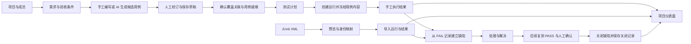
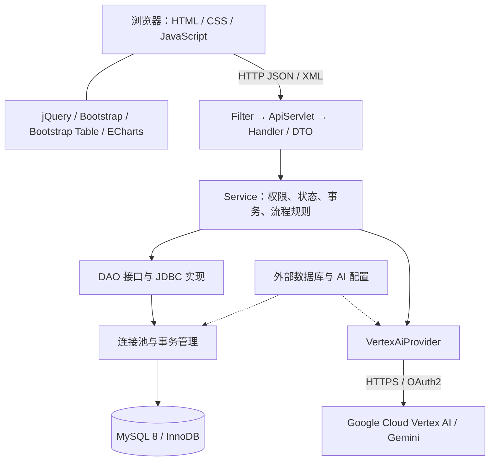
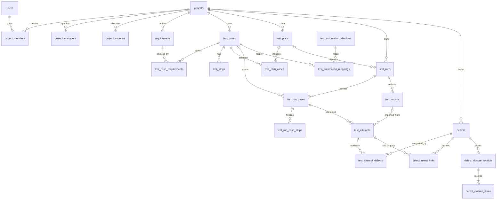

# Veriqra 软件设计说明书（v0.9）

整理日期：2026-10-29；增补核对日期：2026-11-04。依据：代码基线提交 `8259b8a4a49417e87c1505b4e4e404a4b20b237e` 及本次发布准备的工作区增补，版本号 `0.9.0`。

AI 测试运行总结已随 2026-10-31 更新部署至 ECS，见 [功能说明](AI-RUN-SUMMARY.md) 和 [部署记录](ECS-DEPLOYMENT.md)。2026-11-04 发布准备增补管理员 AI 模型设置及 Google 连接、用量、配额和账单状态查询，见 [AI 后台说明](AI-ADMIN.md)；此次上线结果以部署记录为准。两项能力均不新增数据库表。

本文描述已实现的软件结构与业务能力；数据库完整字段、索引、外键和 CHECK 约束见 [数据库数据字典](DATABASE-DICTIONARY-v0.9.md)。旧版阶段文档、历史数据库验证材料中的功能，不直接视为 v0.9 当前功能。

## 1. 项目概述与设计目标

Veriqra 是面向课程期末展示和小型测试项目的软件测试与质量管理平台。系统把需求、测试用例、测试计划、执行结果和缺陷关联起来，使用户能够回答：某项需求由哪些用例覆盖、某次运行执行了什么内容、失败发生在哪条执行记录、缺陷依据哪次复测结果关闭。

核心业务链为：

设计目标：流程完整、信息可追溯、界面便于演示、模块数量适中。AI 负责辅助编写测试用例和分析运行结果；执行结果仍来自人工记录或外部 JUnit 报告。

## 2. 当前功能边界

### 2.1 当前模块

| 模块 | 主要功能 | 输入与输出 | 主要数据表 |
|---|---|---|---|
| 登录与会话 | 用户登录、退出、读取当前用户、会话恢复提示 | 账号信息 → 用户身份与会话 | users；login_events 记录登录事件 |
| 项目工作区 | 创建项目、可访问项目列表、项目详情、搜索并切换项目 | 项目编号、名称、描述 → 当前项目上下文 | projects、project_counters |
| 项目设置 | 查询项目成员、添加已有用户、任命与撤销项目负责人 | 已有用户名、项目角色 → 成员关系 | project_members、project_managers |
| 需求管理 | 新建、查看、编辑需求，维护优先级与状态，描述验收条件 | 需求定义 → REQ 编号和需求版本 | requirements |
| 用例与覆盖 | 用例定义、前置条件、测试步骤、就绪状态；关联需求、确认和移除覆盖关系 | 用例及步骤 → TC 编号、需求覆盖关系 | test_cases、test_steps、test_case_requirements |
| AI 辅助用例 | 基于当前需求和补充要求生成候选，人工编辑、选择、舍弃、保存 | 需求内容 → 3～5 条候选；接受 1～5 条 → 草稿用例 | 无独立 AI 表；复用 test_cases、test_steps、test_case_requirements |
| 测试计划 | 建立计划，加入或移除用例，维护草稿/就绪/归档状态 | 用例集合 → TP 编号与计划成员 | test_plans、test_plan_cases |
| 测试运行与执行 | 从计划或指定用例创建运行，查看冻结内容，记录结果、备注、耗时及失败信息，浏览历史尝试，完成或取消运行 | 计划/用例集合 → 运行快照 → 多次执行记录 | test_runs、test_run_cases、test_run_case_steps、test_attempts |
| 缺陷与复测 | 从失败创建缺陷、分派与处理、解决、补充失败证据、选择复测 PASS、检查关闭条件、关闭、重新打开 | FAIL 证据 → BUG 编号 → 复测与关闭记录 | defects、test_attempt_defects、defect_retest_links、defect_closure_receipts、defect_closure_items |
| 自动化与导入 | 登记 JUnit 测试标识、维护用例映射、XML 预览、正式导入、导入历史和来源查询 | 外部报告与映射 → 已完成运行、用例快照及执行结果 | test_automation_identities、test_automation_mappings、test_imports，以及运行和执行表 |
| 项目仪表盘 | 查看运行进度、失败/阻塞用例、未关闭缺陷、需求覆盖、结果分布和下一步入口 | 项目资产与所选运行 → 指标、ECharts 图表和定位链接 | 查询已有业务表，不额外持久化仪表盘指标 |
| AI 运行总结 | 根据本轮结果、冻结用例和关联缺陷生成概述、问题及建议，支持复制和重新生成 | 运行数据快照 → 服务端统计与 AI 文字分析 | 读取已有表，不新增表；总结保存在当前页面 |
| 用户管理 | 用户搜索、角色/状态筛选、排序、分页，创建和编辑用户、重置密码 | 用户维护表单 → 平台用户信息 | users；audit_logs 保存管理操作记录 |
| AI 设置 | 选择并保存运行时模型，检查 Google 项目连接及模型 Token 计数，读取监测用量、配额和账单状态，提供赠金与费用控制台入口 | 管理员模型选择、服务器已有 Google 配置 → 生效模型与只读查询结果 | 不新增表；模型选择单独保存在 WAR 外的设置文件 |

模块数量按职责划分；左侧菜单并不为每项子功能单独建立页面。例如 AI 用例入口位于需求详情，AI 总结位于运行详情，AI 设置位于管理后台；用例步骤属于用例模块，复测属于缺陷闭环。

### 2.2 已裁撤与未实现的能力

- v0.9 已裁撤小组、任务、任务转交、积分转账、奖励和贡献排行的当前应用入口及相应业务代码；历史表仍保留。
- 管理后台提供用户维护和 AI 设置；日志表继续由系统记录，不等于当前仍提供完整日志管理页面。AI 设置页不提供通用 Google 资源管理，不自动启用 API 或更改 IAM；未取得的用量、配额和账单信息保持未知，赠金余额与费用明细通过 Google 控制台入口查看。
- 系统导入外部 JUnit 测试结果，本身不调度 Jenkins、不启动浏览器自动化、不执行测试脚本。
- AI 候选生成不等于自动测试，不会自动把用例标为通过、自动确认覆盖或自动关闭缺陷。
- 当前没有独立的通用附件管理、站内消息、邮件通知、微服务调度或完整 CI/CD 产品模块。
- 数据模型支持的字段和状态，不等于当前页面必然开放对应编辑入口。例如项目模型保留 ARCHIVED，但项目 HTTP 入口当前主要提供创建和查询。

## 3. 技术架构

### 3.1 总体架构

采用 B/S 架构和单体 WAR 部署。浏览器加载 HTML/CSS/JavaScript，通过 AJAX 调用同源 `/api/*` 接口。服务端以 Servlet 处理 HTTP，以 Service 实现业务规则，以 JDBC DAO 访问 MySQL。

### 3.2 技术选型

| 层次 | 技术与当前版本依据 | 用途 |
|---|---|---|
| Java 运行时 | Java 21 | 编译与服务器运行 |
| Web 标准 | Jakarta Servlet 6.0 | 请求分发、Filter、Session |
| Web 容器 | Tomcat 10.1；当前依赖 10.1.60 | 部署和运行 WAR |
| 数据库 | MySQL 8.0、InnoDB、utf8mb4 | 业务数据、关联、事务与约束 |
| 数据访问 | 原生 JDBC，MySQL Connector/J 9.7.0 | 参数化 SQL、事务与连接管理 |
| JSON | Jackson 2.21.6 | DTO 序列化与反序列化 |
| 页面 | HTML5、CSS、原生 JavaScript | 登录、项目工作区与用户维护 |
| 前端基础 | jQuery 3.7.1、Bootstrap 5.3.8 | AJAX、事件、表单与布局 |
| 用户表格 | Bootstrap Table 1.24.2 | 服务端搜索、筛选、排序、分页 |
| 图表 | ECharts 6.0.0 | 所选运行结果分布 |
| AI | Google Cloud Vertex AI；默认模型配置 gemini-2.5-flash | 结构化候选用例生成 |
| 构建与测试 | Maven、JUnit 5.13.4、Node.js 内置 test runner | Java 构建及 Java/JavaScript 测试 |

Java 依赖版本来自 `pom.xml`，前端组件版本来自随包提供的 vendor 文件。Gemini 模型名称为配置值，可以在外部配置中调整。系统未采用 Spring Boot、MyBatis、Hibernate、Vue 或 React。

### 3.3 后端分层与目录

| 代码区域 | 职责 |
|---|---|
| bootstrap | 应用初始化、组装 Service、建立连接池、检查已有数据库结构 |
| config | 数据库连接与 AI 外部配置、环境变量读取 |
| web / web.handler | 统一 API 入口、路由、请求 DTO、响应 DTO、HTTP 错误转换 |
| service | 项目、需求、用例、计划、执行、缺陷和导入业务规则 |
| service.command / service.query | 写入命令与查询结果模型 |
| service.support | 权限策略、项目归属校验、输入校验、事务抽象 |
| service.ai | AI 提供者接口、Vertex 实现、生成和接受候选用例 |
| service.importing | JUnit XML 解析、报告分析、导入问题描述 |
| model | 用户、项目、需求、用例、运行、缺陷等领域对象与枚举 |
| dao / dao.jdbc | 持久化接口、JDBC 查询和写入实现 |
| jdbc | 自有连接池、事务边界和资源归还 |
| admin | 基础用户维护及内部运行信息、日志记录能力 |

`ApplicationListener` 是组装入口；`ApiServlet` 按路径分派给 Handler。一次业务写入由 Service 统一控制事务，同一事务内的 DAO 使用同一个连接，DAO 不自行提交。

### 3.4 前端结构

主要页面为 `login.html`、`index.html`、`admin/users.html`。工作区在 `index.html` 内按 URL 的片段和查询参数切换模块，并保留 `projectId`、`requirementId`、`testCaseId`、`planId`、`runId`、`runCaseId`、`attemptId`、`defectId` 等定位信息。

| 脚本 | 职责 |
|---|---|
| app.js | 身份初始化、当前项目、模块路由、工作区壳层 |
| api.js | AJAX/API 请求、错误处理与会话恢复协作 |
| workflow-context.js | 当前权限与业务上下文、离开草稿前的确认 |
| project-picker.js | 在原项目 select 上增强可搜索项目菜单，保留原切换流程 |
| test-assets.js | 需求、用例、步骤与覆盖关联 |
| ai-cases.js | 候选用例展示、编辑、选择和接受保存 |
| execution.js | 计划、运行、冻结内容、执行记录与下一条用例 |
| defects.js | 缺陷、失败证据、复测选择和关闭反馈 |
| automation-imports.js / import-history.js | 身份映射、XML 预览与导入、记录恢复和查询 |
| dashboard.js | 统计口径、运行选择、ECharts 和异常定位 |
| project-settings.js | 成员与负责人维护 |
| shell.js / i18n.js / locale-bootstrap.js | 窄屏导航、语言初始化和中英切换 |
| admin/admin.js | Bootstrap Table 用户维护和表单操作 |

样式通过 `assets/css/app.css` 的统一变量控制，用户管理再加载 `admin/admin.css`。页面提供响应式导航、表单换行、表格内横向滚动和键盘可访问操作。当前主色为 `#4668BF`；通过/失败/阻塞等结果色独立表达业务状态。

## 4. 用户角色与权限模型

系统级角色只有 `ADMIN`、`USER`；项目成员角色只有 `TESTER`、`DEVELOPER`。项目负责人通过 `project_managers` 额外记录，不是第三种系统级角色，也不自动获得全部测试资产写权限。

| 操作 | 平台管理员 ADMIN | 活跃项目 TESTER | 活跃项目 DEVELOPER | 项目负责人附加身份 |
|---|---|---|---|---|
| 平台用户维护、创建项目 | 允许 | 不允许 | 不允许 | 不因此获得权限 |
| 读取项目和项目内资产 | 可读取全部项目 | 可读取所属项目 | 可读取所属项目 | 仍需有效项目成员关系 |
| 需求/用例/覆盖/计划/运行/结果写入 | 允许 | 允许 | 不允许 | 由其 TESTER/DEVELOPER 角色决定 |
| AI 生成与接受、JUnit 映射与导入 | 允许 | 允许 | 不允许 | 由其项目角色决定 |
| 创建带 FAIL 证据的缺陷 | 允许 | 允许 | 允许 | 依项目成员规则 |
| 开始处理、标记解决 | 允许 | 允许 | 仅限分配给自己的缺陷 | 不自动扩大缺陷权限 |
| 复测关联、关闭、重新打开、维护失败证据 | 允许 | 允许 | 不允许 | 由其项目角色决定 |
| 添加已有平台用户为项目成员 | 允许 | 仅同时具有负责人身份时 | 仅同时具有负责人身份时 | 允许 |
| 任命/撤销项目负责人 | 允许 | 不允许 | 不允许 | 不允许自行任免 |

账号必须为 ACTIVE，项目成员关系必须有效。归档项目原则上只读。服务端重新读取权限和项目归属，不以按钮是否显示作为授权依据。当前无公开注册流程，由管理员创建平台账号，再建立项目成员关系。

## 5. 关键业务设计

### 5.1 需求、用例及覆盖

需求保存标题、描述、优先级、状态及版本；验收条件写在需求描述中，数据库没有独立的验收条件表。用例保存标题、描述、前置条件和多个有序步骤，每步包含操作与预期结果。

需求与用例是多对多关系，用 `test_case_requirements` 记录。关联状态为 NEEDS_REVIEW、CONFIRMED、REMOVED。确认覆盖、标记就绪是显式操作；修改影响语义的需求或用例内容后，原已确认关联需要重新复核，用例内容变更会回到 DRAFT。已创建运行中的历史快照不随之修改。

### 5.2 AI 用例生成

1. 用户打开需求详情，输入可选补充要求。
2. Service 读取已保存需求并校验权限；实际发给模型的是需求标题、描述（含验收条件）和补充要求。
3. `VertexAiProvider` 调用 Gemini，要求返回具有标题、描述、前置条件、优先级和步骤的 JSON 候选。
4. 正常生成 3～5 条候选；页面允许编辑、舍弃和选择。
5. 接受保存时提交需求的 `expectedVersion` 和 1～5 条选定候选。后端再次核对需求版本，在单一事务中创建用例、步骤与需求关联。
6. 新用例为 DRAFT，关联为 NEEDS_REVIEW；仍需人工确认覆盖并标记用例就绪。

候选生成期间不长期占用数据库连接。候选预览没有独立数据库表；未接受的内容主要保存在页面内存。当前不保存独立 AI 对话、提示词历史或模型调用账单表；保存后的用例也没有专门的“AI 来源”字段。默认每条候选支持 1～30 步。AI 不可用时，页面仍保留手工创建用例入口。

### 5.3 测试计划与运行快照

测试计划是一组当前用例定义的集合，`test_plan_cases` 保存成员、添加人及添加时间，没有独立的排序字段；当前列表按用例编号和 ID 组织。从 READY 计划创建运行时，所选用例也必须 READY 且包含步骤；系统建立运行、运行用例和运行步骤快照。也可不依赖计划，直接从指定用例集合创建临时运行。

需要区分三个对象：

| 对象 | 含义 | 是否随当前用例修改 |
|---|---|---|
| TestCase / TestStep | 当前可维护的测试资产 | 会 |
| TestRunCase / TestRunCaseStep | 创建某次运行时冻结的内容 | 不会 |
| TestAttempt | 按该运行用例记录的一次实际结果 | 新结果追加保存 |

运行记录测试名称、环境、构建版本、起止时间和状态。完成表示该轮运行结束，不能等同“全部通过”；当前执行规则要求运行有用例且用例均已有执行结果。完成/取消后的运行不能继续按普通执行流程追加结果，修复验证可以创建新的运行。

### 5.4 执行结果与历史

实际执行记录的结果只有 PASS、FAIL、BLOCKED、SKIPPED。NOT_RUN 是没有执行记录时的派生展示状态，不是一条可保存的 TestAttempt 结果。

一个运行用例可以有多条尝试记录，保存结果时追加 TestAttempt；当前结果取最新尝试。页面展示冻结步骤、实际备注、失败说明、耗时、操作者和执行时间，并支持前后用例切换。`submissionKey` 用于识别一次提交；重复提交与网络结果不确定时使用已有记录核对机制，避免盲目产生重复尝试。

### 5.5 缺陷、失败证据与复测关闭

缺陷通过同项目的实际 FAIL 尝试建立，并由 `test_attempt_defects` 关联失败证据。一个缺陷可以关联多个失败尝试，一个失败尝试也可关联多个缺陷。处理过程维护标题、描述、严重程度、优先级、报告人、处理人、解决说明和状态。

普通处理流为 `OPEN/REOPENED → IN_PROGRESS → RESOLVED → CLOSED`。重新打开要求提供新的 FAIL 证据。关闭前，后端检查所有有效失败证据对应的复测结果，支持原运行用例内的后续 PASS，以及符合快照语义和时序规则的跨运行复测 PASS。

指定缺陷处理人时，目标必须是活跃 ADMIN 或本项目活跃 DEVELOPER；不能任意指定 TESTER。

跨运行复测通过 `defect_retest_links` 显式记录，包含失败尝试、通过尝试、审查人、审查说明和时间依据。只有“后来有一次 PASS”不足以关闭：还要核对是否同一用例及兼容定义、结果时间顺序、运行与用例引用归属和是否出现更晚的非 PASS 等条件。当前检查结果由 `closure-eligibility` 返回。快照语义比较包含标题、描述、前置条件及步骤，不包含优先级；导入 PASS 还需要人工确认执行时间的依据。

关闭时写入 `defect_closure_receipts` 与 `defect_closure_items`，保存关闭采用的失败与通过证据。关闭不会改写原始失败；关闭记录和当前可关闭性检查也不是同一对象。详细资格规则以业务实现和字典附注为准。

### 5.6 JUnit 报告导入

JUnit XML 导入是“外部测试标识 → 本系统当前用例”的人工映射流程：

1. 选择报告、来源命名空间，进行只读预览。
2. 外部标识由 `JUNIT + classname + testcase name` 识别。
3. 未登记标识先登记，再由用户明确映射到当前项目的 READY 用例。
4. 再次预览，确认每条结果都能正确映射，然后提交正式导入。
5. 正式导入在同一事务内创建导入记录、运行、用例与步骤快照及尝试，运行置为 COMPLETED。
6. 保存原始文件名、报告摘要、请求键、映射和来源关系，支持按请求键核查是否已经成功导入。

当前约束：XML 不超过 5 MiB、最多 10,000 个 testcase；每份报告的 testcase classname 必须与本次 `sourceNamespace` 一致；不接受重复外部标识或多个标识在同次报告中指向同一用例。正式导入前要求有效映射且目标用例 READY。JUnit failure/error 映射 FAIL，skipped 映射 SKIPPED，无结果标记映射 PASS，耗时从秒转换为毫秒。

### 5.7 仪表盘指标口径

| 指标 | 当前实际口径 |
|---|---|
| 需求数、用例数 | 已加载项目需求/用例列表长度，包含其列表返回的归档条目 |
| 当前运行进度 | 所选运行中已有最新结果的用例数 / 运行用例总数 |
| 需关注用例 | 所选运行当前结果为 FAIL 或 BLOCKED 的数量 |
| 项目未关闭缺陷 | 项目中状态不为 CLOSED 的缺陷数，包含 RESOLVED |
| 需求覆盖 | 被同项目 READY 用例以 CONFIRMED 关系覆盖的 ACTIVE 需求数 / ACTIVE 需求总数 |
| 结果环形图 | 所选运行的 PASS、FAIL、BLOCKED、SKIPPED、NOT_RUN 分布 |
| 环形图中央百分比 | 已记录结果比例 `(总数 - NOT_RUN) / 总数`，不是通过率 |

无有效需求或无运行用例时显示空态/“—”，不伪造百分比。运行下拉选择改变运行级指标，项目未关闭缺陷和需求覆盖仍为项目级。历史运行中的失败可以在缺陷关闭后继续存在，因为其展示的是历史执行结果。

## 6. 状态与数据一致性

| 对象 | 状态集合 | 说明 |
|---|---|---|
| 用户 | ACTIVE、DISABLED | 启用/停用 |
| 项目 | ACTIVE、ARCHIVED | 数据模型状态；归档项目只读 |
| 成员/负责人 | ACTIVE、INACTIVE | 身份有效性 |
| 需求 | DRAFT、ACTIVE、ARCHIVED | 草稿、有效、归档 |
| 用例 | DRAFT、READY、ARCHIVED | 草稿、就绪、归档 |
| 覆盖关系 | NEEDS_REVIEW、CONFIRMED、REMOVED | 待复核、已确认、已移除 |
| 测试计划 | DRAFT、READY、ARCHIVED | 就绪计划可用于创建运行 |
| 测试运行 | IN_PROGRESS、COMPLETED、CANCELLED | 进行中、已完成、已取消 |
| 尝试结果 | PASS、FAIL、BLOCKED、SKIPPED | NOT_RUN 仅派生展示 |
| 缺陷 | OPEN、IN_PROGRESS、RESOLVED、CLOSED、REOPENED | 解决与关闭分开 |
| 自动化映射 | ACTIVE、INACTIVE | 当前映射与历史映射状态 |

一致性主要由四部分实现：

1. 数据库使用外键、唯一约束、CHECK，约束引用、编号、枚举和字段组合。
2. Service 在写入时核对操作人、项目归属、状态和语义条件。
3. 可编辑实体使用 `lock_version`，更新带 `expectedVersion`；冲突时反馈并要求读取最新状态。
4. 多表操作共用一个 JDBC 事务，例如用例和步骤保存、AI 候选接受、运行快照创建、JUnit 导入、缺陷关闭记录写入。事务管理器提交成功才返回，不支持嵌套事务或自动重试。

业务编号使用项目级计数器，REQ、TC、TP、BUG 在各项目分别分配，与数据库全局主键 id 不同。引用和接口定位使用 id，页面可读编号由项目内 key_no 格式化。

## 7. 数据库总体设计

数据库安装基线为 `database/schema.sql` 的 32 张表，加上 `database/migrations/20261014-r1-defect-retest.sql` 的 3 张复测表，共 35 张。旧的 19 表冻结模型与 seed/constraint 验证材料属于历史版本，不是当前完整安装脚本。

主要实体关系如下。图省略用户署名外键、部分组合外键、日志表与历史模块，完整约束见字典。

`test_imports.test_run_id` 没有唯一约束，数据库允许一个运行对应多条导入记录；当前正式导入 Service 为每个新请求创建独立运行。普通手工运行没有导入记录。ER 图展示数据库关联，不代表所有表都提供独立维护页面。

### 7.1 全部表目录

当前最终结构有 **35 表、310 字段、82 外键、31 个 UNIQUE KEY、87 个 CHECK**。分类为当前核心 23 表、后台运行记录 3 表、已裁撤功能的历史保留表 9 表。PRIMARY KEY 不计入上述 UNIQUE KEY 数量。

|序号|表名|中文名称|用途|分类|字段数|
|---|---|---|---|---|---|
|1|`users`|用户表|平台账号、显示名称、密码摘要及账号状态。|当前核心功能|9|
|2|`projects`|项目表|质量资产与权限隔离的项目容器。|当前核心功能|9|
|3|`project_members`|项目成员表|用户在项目中的角色与成员状态。|当前核心功能|7|
|4|`project_counters`|项目业务编号计数器|按项目分别分配需求、用例、计划和缺陷编号。|当前核心功能|3|
|5|`requirements`|需求表|需求标题、描述、优先级与生命周期。|当前核心功能|11|
|6|`test_cases`|测试用例表|可编辑的用例定义及前置条件。|当前核心功能|12|
|7|`test_automation_identities`|自动化测试标识表|JUnit source、classname/namespace 和 testcase name 组成外部标识。|当前核心功能|6|
|8|`test_automation_mappings`|自动化映射表|人工确认外部自动化标识与系统用例的对应关系。|当前核心功能|8|
|9|`test_steps`|测试步骤表|当前用例定义的有序操作与预期结果。|当前核心功能|4|
|10|`test_case_requirements`|需求用例关联表|需求与用例的覆盖关系及人工复核状态。|当前核心功能|8|
|11|`test_plans`|测试计划表|按目标组织要执行的测试用例。|当前核心功能|10|
|12|`test_plan_cases`|计划用例成员表|测试计划包含哪些用例。|当前核心功能|4|
|13|`test_runs`|测试运行表|某次执行批次的环境、构建版本和状态。|当前核心功能|12|
|14|`test_run_cases`|运行用例快照表|运行创建时冻结的用例定义。|当前核心功能|8|
|15|`test_run_case_steps`|运行步骤快照表|运行创建时冻结的测试步骤。|当前核心功能|4|
|16|`test_imports`|JUnit 导入记录表|导入来源、报告摘要与幂等请求标识。|当前核心功能|8|
|17|`test_attempts`|测试执行尝试表|同一运行用例可追加多次人工或自动化执行结果。|当前核心功能|13|
|18|`defects`|缺陷表|缺陷描述、严重程度、处理人与处理状态。|当前核心功能|14|
|19|`test_attempt_defects`|失败缺陷证据关联表|将具体执行尝试与缺陷建立证据关系。|当前核心功能|4|
|20|`credit_accounts`|历史积分账户表|保留用户积分余额。|历史保留（已裁撤功能）|4|
|21|`credit_transactions`|历史积分流水表|保留发放、收回、转账和任务奖励流水。|历史保留（已裁撤功能）|11|
|22|`login_events`|登录事件表|后台持续记录登录结果与终端信息。|后台运行记录（无独立维护页面）|11|
|23|`access_logs`|访问日志表|后台持续记录请求、响应状态及耗时。|后台运行记录（无独立维护页面）|13|
|24|`audit_logs`|操作日志表|后台持续记录用户维护等管理操作。|后台运行记录（无独立维护页面）|10|
|25|`project_managers`|项目负责人表|从项目成员中任命项目负责人。|当前核心功能|6|
|26|`project_teams`|历史项目小组表|保留项目内小组及组长资料。|历史保留（已裁撤功能）|9|
|27|`team_members`|历史小组成员表|保留小组与项目成员的关系。|历史保留（已裁撤功能）|6|
|28|`work_tasks`|历史任务表|保留小组任务、执行人、奖励及验收状态。|历史保留（已裁撤功能）|14|
|29|`work_task_events`|历史任务事件表|保留任务状态和执行人变更。|历史保留（已裁撤功能）|10|
|30|`task_handoff_offers`|历史任务转交邀约表|保留附带积分的任务转交邀约。|历史保留（已裁撤功能）|12|
|31|`credit_transfers`|历史积分转账表|保留项目内成员互转与任务转交支付记录。|历史保留（已裁撤功能）|9|
|32|`contribution_events`|历史贡献事件表|保留任务验收完成时的贡献积分。|历史保留（已裁撤功能）|7|
|33|`defect_retest_links`|缺陷复测关联表|为原始失败选定另一次兼容的通过结果，并记录撤销或替换。|当前核心功能|20|
|34|`defect_closure_receipts`|缺陷关闭回执表|冻结一次缺陷关闭时使用的说明、版本与证据数量。|当前核心功能|8|
|35|`defect_closure_items`|缺陷关闭证据明细表|冻结关闭回执中每个原始失败及采信通过结果。|当前核心功能|6|

字段完整信息另见 [35 表数据字典](DATABASE-DICTIONARY-v0.9.md)。其中逐表列出字段类型、可空性、默认值、生成列、主键、唯一键、普通索引、外键及 CHECK。

## 8. HTTP 接口设计

接口统一位于 `/api`。下文 `P=/api/projects/{projectId}`，`D=P/defects/{defectId}`，`A=/api/automation/identities/{identityId}`。成功返回资源 JSON/列表，创建一般为 201，无响应体动作一般为 204；导入幂等重放可返回 200。

### 8.1 登录、项目和用户

| 方法 | 路径 | 功能 |
|---|---|---|
| POST | /api/auth/login | 登录并建立会话 |
| POST | /api/auth/logout | 退出登录 |
| GET | /api/auth/me | 当前用户 |
| GET / POST | /api/projects | 可访问项目列表 / 管理员创建项目 |
| GET | P | 项目详情 |
| GET / POST | P/members | 成员列表 / 添加已有用户 |
| GET / POST | P/managers | 负责人列表 / 管理员任命 |
| DELETE | P/managers/{userId} | 撤销负责人身份 |
| GET / POST | /api/admin/users | 用户分页查询 / 创建用户 |
| GET / PATCH | /api/admin/users/{userId} | 用户详情 / 修改用户 |
| POST | /api/admin/users/{userId}/reset-password | 重置密码 |
| GET | /api/admin/system | 内部管理员运行信息；当前后台无独立系统维护页面 |
| GET / PUT | /api/admin/ai | 读取 AI 设置 / 保存运行时模型选择 |
| POST | /api/admin/ai/refresh | 只读查询 Google 连接、用量、配额和账单状态 |
| POST | /api/admin/ai/check-model | 检查当前生效模型的 Token 计数，不生成内容 |

### 8.2 需求、用例、覆盖与 AI

| 方法 | 路径 | 功能 |
|---|---|---|
| GET / POST | P/requirements | 需求列表 / 创建需求 |
| GET / PUT | P/requirements/{requirementId} | 需求详情 / 编辑需求 |
| GET | P/requirements/coverage | 项目需求覆盖批量统计 |
| GET | P/requirements/{requirementId}/test-cases | 需求关联用例 |
| POST | P/requirements/{requirementId}/test-cases/{testCaseId} | 建立覆盖关联 |
| POST | 上述关联路径/confirm 或 /remove | 确认或移除覆盖关联 |
| POST | P/requirements/{requirementId}/ai-cases/preview | 生成候选 |
| POST | P/requirements/{requirementId}/ai-cases/accept | 接受候选并创建草稿用例 |
| GET / POST | P/test-cases | 用例列表 / 创建用例及步骤 |
| GET / PUT | P/test-cases/{testCaseId} | 用例详情 / 编辑定义、步骤与状态 |
| GET | P/test-cases/{testCaseId}/requirements | 用例覆盖的需求 |

### 8.3 计划、运行与执行

| 方法 | 路径 | 功能 |
|---|---|---|
| GET / POST | P/test-plans | 计划列表 / 新建计划 |
| GET / PUT | P/test-plans/{planId} | 计划详情 / 编辑计划与状态 |
| POST | P/test-plans/{planId}/test-cases/{testCaseId} | 计划添加用例 |
| POST | 上述路径/remove | 从计划移除用例 |
| POST | P/test-plans/{planId}/archive | 归档计划 |
| GET / POST | P/runs | 运行列表 / 从计划或用例集合创建运行 |
| GET | P/runs/{runId} | 运行、快照和当前结果 |
| POST | P/runs/{runId}/complete 或 /cancel | 完成或取消运行 |
| GET | P/runs/{runId}/completion-impact | 完成运行前的影响信息 |
| POST | P/runs/{runId}/ai-summary | 根据当前保存的本轮数据生成 AI 总结，请求语言 zh-CN/en |
| GET / POST | P/runs/{runId}/cases/{runCaseId}/attempts | 历史尝试 / 新增执行结果 |
| GET | P/runs/{runId}/cases/{runCaseId}/attempts/{attemptId}/defects | 直接关联该次尝试的缺陷 |

### 8.4 缺陷与复测

| 方法 | 路径 | 功能 |
|---|---|---|
| GET / POST | P/defects | 缺陷列表 / 从 FAIL 创建缺陷 |
| GET / PUT | D | 缺陷详情 / 编辑 |
| POST | D/start、D/resolve、D/close、D/reopen | 开始处理、解决、关闭、重新打开 |
| POST | D/evidence | 添加失败证据 |
| POST | D/evidence/{attemptId}/remove | 移除误关联证据 |
| GET | D/closure-eligibility | 关闭条件与当前证据检查 |
| GET | D/retest-candidates | 为指定失败列出复测候选，支持游标分页 |
| POST | D/retests | 人工关联复测 PASS |
| POST | D/retests/{linkId}/revoke | 撤销复测关联 |
| GET | D/retest-operations/{requestKey}?action=LINK或REVOKE | 查询不确定请求的已保存结果 |

### 8.5 自动化标识与报告导入

| 方法 | 路径 | 功能 |
|---|---|---|
| GET / POST | P/automation/identities | 项目标识列表 / 登记标识 |
| GET | P/automation/mappings | 项目映射列表 |
| GET | A | 外部标识详情 |
| GET / PUT | A/mapping | 当前有效映射 / 建立或调整映射 |
| POST | A/mapping/deactivate | 停用映射 |
| POST | P/imports/preview | XML 只读预览与映射分析 |
| POST | P/imports | 正式导入 XML |
| GET | P/imports，允许 runId 查询参数 | 导入历史 / 运行来源查询 |
| GET | P/imports/{importId} | 导入结果详情 |
| GET | P/imports/requests/{requestKey} | 按请求键核查导入结果 |

### 8.6 数据交换与错误反馈

普通写接口接收 JSON；报告导入直接接收 `application/xml` 字节。预览查询参数为 `sourceNamespace`；正式导入另需 `requestKey`、`originalFilename`、`runName`，可选 `environment`、`buildVersion`。这不是通用文件附件接口。普通 JSON 请求体当前上限 64 KiB。

错误对象采用 `{ "error": { "code": "...", "message": "...", "reasonCode": "...", "field": "..." } }`，部分附加字段可为空。常见 HTTP 状态为 400 输入不合法、401 未登录、403 权限不足、404 资源不存在、409 版本或业务状态冲突。AI 不可用和超时分别使用 503/504；页面据此展示重试、最新状态或手工编写入口。

## 9. 数据库字段设计约定

- 全局实体通常使用 `id BIGINT` 自增主键；成员、步骤和关联等表可采用组合主键，详见逐表字典。
- 项目内业务编号采用 `key_no`，在对应项目及实体类型内唯一。
- 枚举通常采用区分大小写的 ASCII VARCHAR 与 CHECK 限制；并非数据库 ENUM 类型。
- 中文业务文本采用 utf8mb4；多数时间字段为 `DATETIME(6)`。数据库连接及脚本以 UTC 处理，页面按显示规则格式化。
- `created_at`、`updated_at` 保存记录时间；是否有默认值、是否由 Service/DAO 更新，以每表定义为准。
- `lock_version` 用于乐观锁；不是所有关系表都具有该列。
- 状态、归档或关系移除优先保留历史语义；不提供一键物理删除整个项目历史的业务流程。
- 外键负责引用完整性，跨表同项目、快照兼容和时间先后等语义仍需 Service 校验。
- `test_imports` 存报告摘要与元数据，不能据此声称系统持久化了可重新下载的完整原 XML 文件。

## 10. 运行与部署设计

系统构建为单个 `veriqra-0.9.0.war`，可部署为 Tomcat ROOT 上下文，也可部署在 `/veriqra` 等子路径。浏览器、Servlet 和数据库为清晰分层的单体应用，AI 是外部调用能力。

数据库连接与 AI 凭据保存在 WAR 外部，通过配置文件及 `VERIQRA_DB_*`、`VERIQRA_AI_*` 等环境变量读取。默认 AI 配置包含 project、location、model、credentials；后台保存的独立模型选择覆盖默认 model，新请求使用已保存模型，进行中的请求保留原模型。本文不包含真实账号、口令、私钥或生产数据库连接详情。

前端组件随 WAR 提供本地 vendor 文件，不依赖访问第三方 CDN。构建为一方脚本和样式生成包含提交与内容摘要的资源版本参数，以区分更新前后的缓存内容。

运行所需：Java 21、Tomcat 10.1、MySQL 8、已有数据库结构和用户；使用 AI 时另外配置 Google Cloud 项目、Vertex API 和服务账号凭据。系统基本会话使用 Cookie 和服务端 Session，当前配置超时 30 分钟。

本文为软件设计说明，不把“有部署包”作为线上验收结论。实际发布/部署状态应结合构建提交、部署记录与服务器核验；历史 README 和发布文档的状态日期需要按当次工作进展判断。

## 11. 测试与验收设计

| 层次 | 验证内容 | 主要材料 |
|---|---|---|
| Java 单元测试 | 模型、状态、Service 规则、DTO、解析器和 Web 协议 | src/test/java |
| MySQL 集成测试 | DAO SQL、事务、外键/唯一/CHECK、并发与跨表业务规则 | 独立测试库与 mysql-tests profile |
| JavaScript 测试 | 路由、草稿、会话恢复、AI 候选、执行、缺陷、导入和仪表盘 | src/test/js |
| WAR 部署检查 | ROOT/子路径资源、初始化、构建信息与接口可用性 | WarDeploymentSmoke |
| 浏览器操作验收 | 登录、需求→用例→计划→运行→缺陷→复测、界面与响应式 | 本地/线上实际页面和明确标记的演示数据 |

仅修改文档不需要重跑全部业务回归。测试数量是特定提交和测试执行的结果，不在本设计说明中将历史测试数当作永久指标。演示数据与真实产品测试结果需要标记清楚；ZZZSwitch 课程演示中的人工结果不能作为对真实游戏客户端的实测结论。

## 12. 演示与答辩可采用的说明

“Veriqra 采用 Java Servlet、分层 Service 和 JDBC 构建测试管理平台。以项目隔离需求、用例、计划、执行和缺陷，支持 Gemini 辅助编写用例与 JUnit 报告导入。运行创建时冻结用例内容，执行结果按尝试追加保存；缺陷关联真实失败记录，并通过后续复测与关闭记录形成可追溯闭环。前端采用 Bootstrap、Bootstrap Table 和 ECharts 展示业务列表及测试结果。”

建议展示一条完整链路：选项目 → 打开需求 → AI 候选和人工校订 → 用例就绪与覆盖确认 → 计划创建运行 → 记录 FAIL → 从失败建立缺陷 → 标记解决 → 修复版运行记录 PASS → 关联复测并关闭 → 首页查看历史首轮与修复轮的不同结果。

## 13. 核对依据

| 内容 | 当前实现依据 |
|---|---|
| 依赖与打包 | pom.xml |
| 页面与 API 路径 | src/main/webapp/index.html、admin/users.html、admin/ai.html；web/ApiServlet.java、web/handler/*.java |
| 分层组装 | bootstrap/ApplicationListener.java |
| 权限与项目归属 | service/support/ProjectAccessPolicy.java、DefaultProjectSettingsService.java |
| 需求、用例、覆盖、计划、运行 | 对应 Default*Service.java 与 dao/jdbc 实现 |
| AI | service/ai/AiCaseService.java、AiRunSummaryService.java、AiSettingsManager.java、VertexAiProvider.java、admin/GoogleAiDashboard.java；前端 ai-cases.js、ai-run-summary.js、admin/ai.js |
| 缺陷与关闭 | DefaultDefectService.java、DefaultDefectRetestWorkflow.java、model/DefectClosureEvidencePolicy.java |
| 导入 | DefaultTestImportService.java、service/importing/JUnitXmlParser.java |
| 仪表盘口径 | assets/js/dashboard.js、JdbcTestCaseRequirementDao.java |
| 完整表结构 | database/schema.sql + migrations/20261014-r1-defect-retest.sql |
| 历史模块保留边界 | 当前 ApiServlet 路由、当前页面、README 和 database/README.md |
